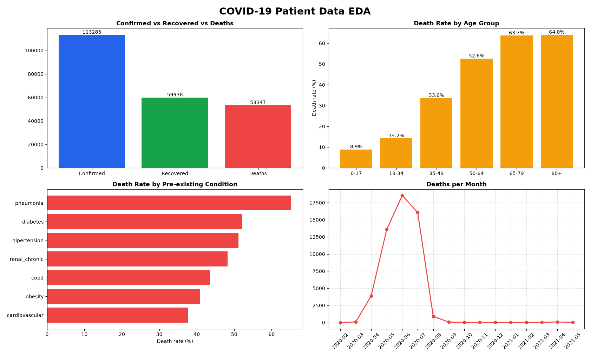

# COVID-19 Patient Data: Exploratory Data Analysis

## Overview
EDA on the Mexico COVID-19 patient-level dataset (1M+ rows, 21 columns) using Python, Pandas and Matplotlib.

## What I Did
1. **Data Exploration:** Checked shape, columns, missing values and duplicates
2. **Data Cleaning:**
   - Removed duplicates and invalid ages
   - Converted coded missing values (97/98/99) to missing
   - Mapped 1/2 codes to Yes/No and Male/Female
   - Created a `died` flag from `DATE_DIED` (9999-99-99 = alive)
   - Defined confirmed cases (classification 1 to 3) and recovered (confirmed and alive)
3. **Analysis:** Confirmed cases, recoveries and deaths, by age, sex and pre-existing conditions
4. **Visualization:** 4 graphs with Matplotlib

## Key Insights
1. Death rate rises sharply with age: 8.87% (0-17), 33.62% (35-49), 52.62% (50-64), 64.02% (80+)
2. Average age of deceased patients (61.5) is about 11 years higher than survivors (50.1)
3. Male patients had a higher death rate (52.58%) than female patients (39.51%)
4. Pneumonia had the highest death rate (65.09%), followed by diabetes (52.11%) and hypertension (51.16%)
5. Of 113,285 confirmed patients, 59,938 recovered (about 52.9%) and 53,347 died

## Limitation
The data covers hospital patients, so the death rate (47.09%) is much higher than in the general population.

## Visualization

## Tools
Python, Pandas, Matplotlib, VS Code

## How to run
1. Download the dataset (Kaggle: COVID-19 Mexico patient data) and place it in the same folder
2. Change the file path inside `covid_eda.py` to your own path
3. Run: `python covid_eda.py`

## Portfolio
🌐 [faiez-ahmed.netlify.app](https://faiez-ahmed.netlify.app/)
